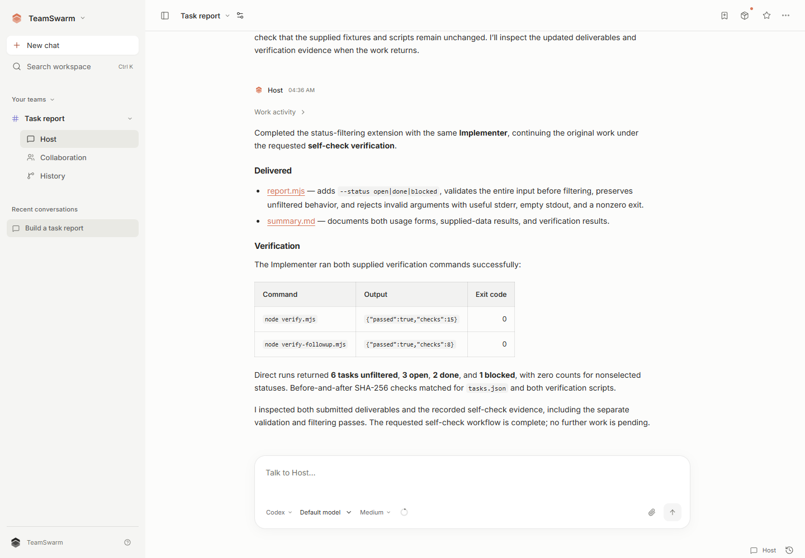

# TeamSwarm

**A local workspace for teams of coding agents.**

Give a team a goal, follow its work, and keep the conversations and deliverables together. TeamSwarm coordinates agents running in independent harnesses, preserves project context between turns, and records the files and checks behind each delivery.

[简体中文](README.zh-CN.md) · [Install](docs/en/installation.md) · [First project](docs/en/getting-started.md) · [Harnesses](docs/en/harnesses.md) · [Contribute](CONTRIBUTING.md)



## What you can do

- **Keep one project conversation.** Discuss the goal with the Host while members work on assigned responsibilities.
- **Use different harnesses.** Choose Codex, Claude Code, Grok, Pi, DeepSeek Harness, or OpenCode, with each agent retaining its native execution loop and tools.
- **Continue work across turns.** Ask questions, request a revision, and return to the same work thread and its earlier deliverables.
- **Inspect the result.** Open and download delivered files, compare versions, and see the self-check or independent review attached to the work.
- **Keep project history.** Preserve decisions, conversations, work and local file snapshots in your workspace.

TeamSwarm is designed for local, single-user code and text projects. Your selected harnesses call the model services you configure. Bring your own supported account or API credentials; provider usage is billed by that provider.

## Install

Download a package from [Releases](https://github.com/DrPei12/teamswarm/releases) and follow the [installation guide](docs/en/installation.md). The desktop package includes Electron, Node.js and Codex. Additional harnesses are installed on your device when you choose them.

| Platform | Package | Support |
|---|---|---|
| Windows x64 | `.exe` | 0.4.0 download |
| Linux x64 | `.deb`, `.AppImage` | Build from source |
| macOS Apple Silicon | `.dmg`, `.zip` | Build from source |

See [platform support](docs/en/platforms.md) for architectures and build formats. Updates are installed manually. See [data and recovery](docs/en/data-and-privacy.md) before moving an existing workspace to another device.

## Your first project

1. Open TeamSwarm and create a team with an empty project folder.
2. Open the team's execution settings, select Codex and connect your account, or configure a supported API-backed harness.
3. Copy the [task report example](examples/task-report/README.md) into the project folder.
4. Send its task prompt to the Host. Open the delivered files and the verification result.
5. Ask for the follow-up change and compare the new version with the original.

The [step-by-step tutorial](docs/en/getting-started.md) includes the exact prompt, expected output and checks.

## Run from source

Install Node.js 24, download or clone this repository, and run these commands in its root:

```sh
npm ci
npm run build
npm start
```

The launcher opens a connected browser at `http://127.0.0.1:4317`. For a desktop build, see the [developer guide](docs/en/development.md). On macOS/Linux, the source web service accepts environment-based API credentials; the desktop application uses the system keyring.

## Documentation

| Guide | Contents |
|---|---|
| [Getting started](docs/en/getting-started.md) | Configure a team, finish a task and revise its delivery |
| [Harnesses and models](docs/en/harnesses.md) | Installation, login, API connections and session support |
| [Working with a team](docs/en/usage.md) | Work, conversations, resources, artifacts and history |
| [Troubleshooting](docs/en/troubleshooting.md) | Connection errors, permissions, interruptions and recovery |
| [Data and privacy](docs/en/data-and-privacy.md) | Storage, provider requests, credentials and backups |
| [Architecture](docs/en/architecture.md) | Service, state, harness adapters and delivery model |
| [Development](docs/en/development.md) | Tests, source builds and desktop packaging |

## Contributing

Bug reports, documentation improvements and focused pull requests are welcome. Start with [CONTRIBUTING.md](CONTRIBUTING.md). Report vulnerabilities through the process in [SECURITY.md](SECURITY.md).

## License

TeamSwarm is licensed under [Apache-2.0](LICENSE), allowing commercial use, modification and redistribution. Third-party software retains its respective licenses; see [THIRD_PARTY_NOTICES.md](THIRD_PARTY_NOTICES.md).
