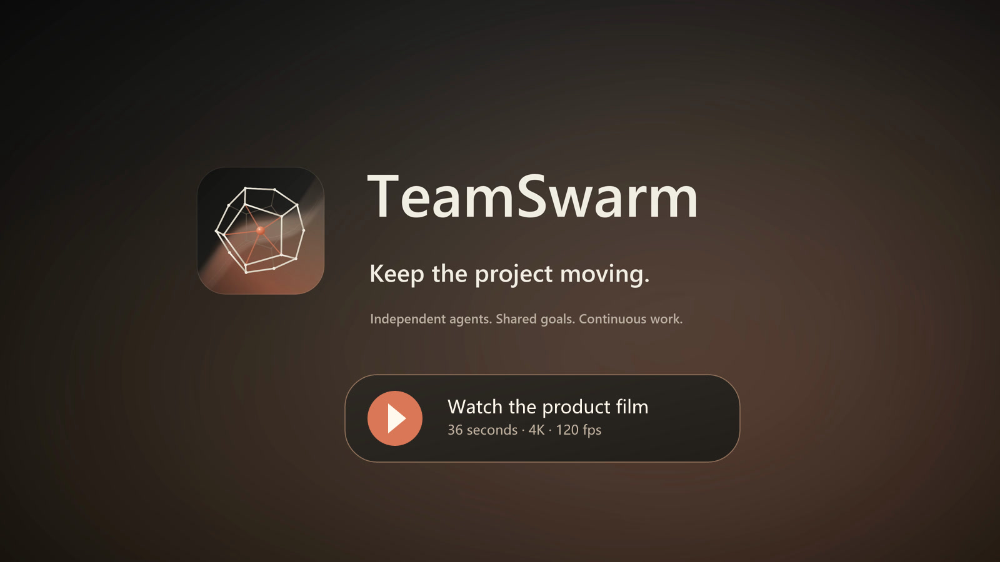

# TeamSwarm

**A local workspace for teams of AI agents.**

TeamSwarm is for AI builders working on code and text projects across multiple agents, sessions and revisions. Discuss a goal with the Host, let members work in independent harnesses, and keep the current decisions, work and deliverables together.

[简体中文](README.zh-CN.md) · [Install](#install) · [First project](#first-project) · [Harnesses and models](#harnesses-and-models) · [Data and recovery](#data-and-recovery)

[](https://github.com/DrPei12/teamswarm/releases/download/v0.6.0/TeamSwarm-launch-film-4K120-EN.mp4)

[▶ Watch the product film](https://github.com/DrPei12/teamswarm/releases/download/v0.6.0/TeamSwarm-launch-film-4K120-EN.mp4) · 36 seconds · 4K / 120 fps · [中文版](README.zh-CN.md)

- **Keep project decisions aligned.** Maintain current project definitions with their sources. Adopt a discussion branch into the mainline after an explicit decision, with document changes visible in project history.
- **Continue the same work.** Revise a deliverable in its original work thread, keeping requirements, file ownership and earlier versions available across sessions.
- **Coordinate independent agents.** Use Codex, Claude Code, Grok, Pi, DeepSeek Harness or OpenCode. Members exchange messages; duplicate responsibilities reuse existing work, and waiting members resume when new information arrives.
- **Inspect what was delivered.** View and download saved file versions, distinguish progress from completed results, and read the self-check or independent review associated with a submission.
- **Follow the project in two canvases.** The collaboration canvas shows members and recorded communication. The history canvas connects discussion, decisions, work, document changes and deliverables.

TeamSwarm runs locally for a single user. Harnesses use the accounts or API connections you configure; model usage is billed by the provider. Native tools run with the operating-system account and permissions you grant.

<a id="install"></a>
## Install

Download the Windows x64 installer and `SHA256SUMS.txt` from the same [GitHub Release](https://github.com/DrPei12/teamswarm/releases). The desktop package includes Electron, Node.js, npm and Codex. Additional harnesses are installed separately on your device.

| Platform | Format | Availability |
|---|---|---|
| Windows x64 | NSIS `.exe` | Release download; installation and upgrade verified |
| Linux x64 | AppImage, DEB | Source build; native installation and runtime verification pending |
| macOS Apple Silicon | DMG, ZIP | Source build; native installation and runtime verification pending |

The Windows installer is unsigned and Windows displays an unknown publisher. Compare its hash with the release checksum file:

```powershell
Get-FileHash .\TeamSwarm-0.6.0-Windows-x64.exe -Algorithm SHA256
```

Run the installer, then open **TeamSwarm** from the Start menu. Installation is per user. For upgrades, close the application, [back up service data](#data-and-recovery), and run the new installer using the same OS account and installation directory. Updates are installed manually. Uninstalling preserves service data and your project files.

<a id="first-project"></a>
## Your first project

Use the synthetic [task report example](https://github.com/DrPei12/teamswarm/tree/main/examples/task-report) to complete a task, check its output and continue the same work.

1. Copy `tasks.json`, `verify.mjs` and `verify-followup.mjs` from the example into a project folder.
2. Open TeamSwarm, create a team and select that project folder in its execution settings.
3. Connect an existing supported account or configure an [API connection](#harnesses-and-models). Check that the selected harness and resource are available.
4. Send this task to the Host:

This example's command checks require an available Codex resource. Other harnesses can create and revise the files, with a Codex member running the checks.

```text
Create report.mjs using only the Node.js standard library.
Usage: node report.mjs <json-file>.
Input must be an array. Each record needs a unique nonempty string id,
a nonempty string title, and status equal to open, done or blocked.
Validate every record. Reject invalid JSON, invalid records, duplicate IDs,
and missing or extra command-line arguments.
Print exactly one JSON value with total and byStatus counts for all three
statuses, including zeros. An empty array returns all zeros.
On failure, exit nonzero, write a useful error to stderr and leave stdout empty.
Keep tasks.json and both verification scripts unchanged.
Create summary.md with usage, the supplied-data result and verification command.
Use a Codex member to run node verify.mjs, address failures,
and deliver report.mjs and summary.md.
```

Open the delivered files and the check result. The supplied data should produce:

```json
{"total":6,"byStatus":{"open":3,"done":2,"blocked":1}}
```

You can run `node verify.mjs` in the project folder to check real process output, exit status and invalid inputs.

Choose **Continue modifying** on the delivered work, or ask the Host to continue that thread:

```text
Extend the same report.mjs to accept:
node report.mjs <json-file> --status open|done|blocked
Preserve the original unfiltered behavior. Validate the entire input before
filtering, including records that do not match. Count matching records and
include zero counts for other statuses. Reject unknown, missing or duplicate
flags with nonzero exit and empty stdout.
Update summary.md. Keep the supplied data and checks unchanged.
Run node verify.mjs and node verify-followup.mjs.
Deliver updated versions of report.mjs and summary.md.
```

Open **Results and reasoning**, open **Current results**, expand a file and use **Version** to select its earlier and current versions. Close and reopen TeamSwarm, return to the same team and ask a read-only question about the work. A compatible harness can resume its native session; otherwise, a new session continues from saved project facts.

**Removed members** in **Collaboration** retains their conversations and work as read-only history. Removed members cannot receive new messages. If a message fails because its execution configuration changed, correct the configuration and retry the original message; the retry preserves its message and work identity.

## Device resources and queued tasks

The Host receives device memory, CPU, process usage, active work and resource settings when planning work. The runtime recalculates admission before each start. Team and service concurrency follow available resources and measured execution costs.

Ask in the conversation to “reserve 8 GiB for other apps” or “restore automatic reservation.” Settings persist on this device and apply across all Teams in the service. Windows checks physical memory and commit headroom separately, alongside a CPU budget. Per-harness estimates adapt to measured execution, and starting tasks reserve their expected cost before the next sample.

When resources delay tasks, the conversation shows the reason, affected tasks and default action. Running work continues. Users can change the reserve or task plan; without new instructions, tasks stay queued and resume when resources recover. A follow-up notice confirms actual execution. Notices are grouped during one continuous wait, with queue and notification state preserved across service restarts. One Host control turn remains available within actual device headroom so users can reduce an oversized reserve.

Windows provides process-level sampling and owned process-group totals. Other systems currently use device memory and CPU samples with conservative startup estimates; process-level cost learning requires a sampler for that platform.

<a id="harnesses-and-models"></a>
## Harnesses and models

A harness runs an agent's tools and execution loop. A model connection supplies its model API. An execution resource combines a harness, model, connection, permissions and supported reasoning settings.

| Harness | Installation | Native session continuation |
|---|---|---|
| Codex | Included in desktop packages; installed CLI also supported | When configuration and context remain compatible |
| Claude Code | Separate device installation | Supported |
| Grok | Separate device installation | Supported |
| Pi | Separate device installation | Supported |
| DeepSeek Harness | Separate device installation | A new native session reads saved TeamSwarm work |
| OpenCode | Separate device installation | Supported |

Integration versions are pinned in [config/harnesses.json](config/harnesses.json). Harnesses own their tools, permissions and sessions; independent connections supply models. A connection can be assigned to any of the six harnesses. The local service translates Responses, Chat Completions and Anthropic Messages when their protocols differ.

In Team capabilities, enable harnesses and add model connections separately. Select **ChatGPT → Continue with ChatGPT**, authorize on the official page, load the account's model catalog and choose models for the Host to allocate. Claude Code can use that ChatGPT connection while running its own commands, handling tool results and continuing its native session. **ChatGPT (Codex)** retains the original Codex account path.

ChatGPT connections use independent [Sign in with ChatGPT](https://developers.openai.com/siwc/token-sharing-open-source/sign-in) authorization, account-specific models and authorized plan usage. Windows encrypts renewable credentials with the operating system. Refresh, sign-out and reauthorization are serialized per account. Pending sign-ins can be cancelled and restarted. Sign-out stops local use and requests remote revocation; the interface provides recovery instructions if remote revocation fails.

For an API connection:

1. Install the harness needed for the task.
2. Enter the provider's official base URL and a model available to your account.
3. Select the provider's protocol, such as Responses, Chat Completions or Anthropic Messages.
4. Save the key through the desktop credential store, or provide an environment-variable reference.
5. Check availability and run a small task with an actual tool call.

For example, a DeepSeek connection uses `https://api.deepseek.com` and Chat Completions. Pi can consume it natively, while Claude Code can use protocol translation. Use a model from the provider's current account model list.

Translation supports text, embedded images, function tools, tool results, streaming and JSON Schema output. Each execution receives a separate route and temporary credential, revoked when execution ends. One service shares one loopback listener, admitting up to 32 simultaneous model requests and 8 per execution route; excess requests receive a busy response. Input is limited to 8 MiB and output to 16 MiB. Native-session model metadata is retained up to 16 MiB; reaching that limit requires a new session and preserves existing records. Provider-hosted tools and exact cross-protocol token counting require separate support; unsupported requests return specific errors.

For environment credentials, set a variable such as `DEEPSEEK_API_KEY` before starting the service and enter only its name in the resource. `TEAM_CREDENTIAL_FILES` accepts a JSON map of environment-variable names to absolute, one-line secret files.

In **Resources and allocation**, work-specific resources take precedence over member defaults. Each attempt captures its actual configuration; edits affect subsequent work. Resource export/import carries configuration and secret references. Configure the referenced credentials on the destination device.

**File access** controls read-only or project-write access; **Execution permissions** controls native tool approvals. Codex and Claude Code offer **Request approval**, **Automatic review** and **Full access**; Claude Code also offers **Accept edits**. Settings retain each Harness's native permission structure. Pending requests appear in the Host and relevant member conversation, where users can allow once or decline. Read-only work retains its boundaries, existing resources retain their permissions, and other Harnesses keep their existing native policies.

Pi and OpenCode accept **Maximum output tokens** (`maxOutputTokens`, default 8192) and **Context window tokens** (`contextWindowTokens`, default 131072). API connections using protocol translation also accept an output limit. ChatGPT plan connections use the service's output limits and reject a custom output-limit override. Context-window overrides remain specific to Pi and OpenCode. Input, reasoning and output share the model's context capacity; the output limit includes reasoning tokens. Length-limited failures remain visible for recovery.

For Pi Chat Completions, **Effort** accepts `minimal`, `low`, `medium`, `high`, `xhigh` or `max` when supported by the provider. Translated Responses or Chat Completions connections accept their model's supported effort values independently of the Harness. Leave effort blank for provider defaults. Pi loads applicable project instructions through its native context loader, without enabling extension code through that loader.

<a id="work-and-results"></a>
## Work and results

Give the Host a goal, relevant files and completion conditions. Members own explicit file or directory scopes; non-overlapping bounded work can run in parallel. File tools compare the current hash before writing. For revisions, continue the original thread so it retains its requirements, file scope and unpublished candidate work.

The Host and members start with a project overview, current responsibilities and a searchable material index. They retrieve task-related definitions, decisions and original messages as needed; handoffs carry references to the relevant material and its dependencies. Long documents and source lists support version-bound pagination. Project notes retain their original sources and flag changed definitions, work or files for rechecking.

Context selection uses the model's configured or observed capacity, recent native token usage and task relevance. It reserves space for replies and tools, preserves native compaction, and rebuilds a session from saved project material when necessary. Unknown capacity and usage use explicit estimates. Legacy message-count, byte and turn-count limits no longer control Host context selection or session reuse.

Select a work thread before asking a member a question. Read-only questions inspect existing work; **Continue modifying** creates a subsequent execution with the original verification requirements. Pause or stop conflicting work and wait for its actual state to settle before editing the same files.

Small reversible changes can use a producer self-check. For independent acceptance, specify a separate reviewer and checks against the submitted version. File reviews can compare submitted content directly. Command-based acceptance currently requires a Codex reviewer with native check support. When review instructions change, the reviewer must read them and rerun the required commands before accepting the result.

Each acceptance criterion records whether it needs semantic inspection or observed command execution. Required command checks stay attached to the work across continuations and resource changes. Every execution criterion must cite successful events from the current review attempt against the submitted artifact versions and current instructions. Unclassified criteria remain pending until the Host sets their evidence requirements; previous acceptance records remain in history.

To adopt a discussion branch, state the decision and scope to the Host in that branch. The Host compares the source, branch base and current mainline, then updates the selected project documents. Open the adoption node in history to inspect the decision, sources, ideas and document differences. Request code implementation separately when needed.

Progress updates and completed deliverables have separate entries. Saved artifact versions remain downloadable even when a full workspace snapshot is unavailable. Restoring a file version creates a new current version; active writers, unsaved local edits or a changed current version must be resolved first. Creating a workspace branch from history requires a saved file snapshot. External actions retain their own state.

The right file panel browses project files and opens multiple tabs for Markdown, images, PDF, Word, Excel and PowerPoint. Edit code, text, and text or cells in modern Office files; fit previews to the panel or adjust zoom. Unsaved edits remain in local drafts, and saving checks the original file version. Finish or stop active member writes in that workspace before saving.

Manually created history checkpoints have a context menu for deletion while the original history and existing branches remain traceable. Member conversations share the Host composer's Harness, model and effort controls; changes apply to subsequent executions.

Delete an idle member from its card's context menu or conversation header, or ask Host to use `team_remove_member`. Conversations, work and results remain in history. Finish pending work, review, exchanges and messages first. Removed members no longer receive work or messages. The standalone Web service and desktop client serve the same current frontend build.

<a id="data-and-recovery"></a>
## Data and recovery

Teams, conversations, work, artifact versions and project history are stored locally. Project files remain in the folders you select.

Members save their continuation and end the current turn while waiting for messages. New messages or dependency results resume execution. Idle Codex executors release their processes, and later tasks resume the saved native session. TeamSwarm Codex sessions load the assigned Team tools and native capabilities. On Windows, each executor and its descendants belong to an owned process group that is reclaimed when the executor or service exits.

Concurrency follows both Team settings and available memory. New tasks queue under memory pressure while active tasks continue, then dispatch when capacity returns. Member identities, history and results remain stored locally.

| Platform | Default service data directory |
|---|---|
| Windows | `%LOCALAPPDATA%\TeamSwarm\data` |
| macOS | `~/Library/Application Support/TeamSwarm/data` |
| Linux | `${XDG_DATA_HOME:-~/.local/share}/TeamSwarm/data` |

`TEAM_DATA_DIR` selects another service directory. Window state and pending, unsubmitted inputs use Electron's TeamSwarm user-data directory, which is `%APPDATA%\TeamSwarm` on Windows. Back up project files and pending inputs separately.

The selected harness sends prompts and relevant project content to its configured provider and may keep its own native session records. The local API listens on `127.0.0.1` and uses a local control credential. Keep `control.json`, databases and account/session records private.

Saved Windows keys use current-account DPAPI. macOS desktop builds use Keychain-backed encryption; Linux desktop builds require a supported unlocked system keyring and reject plaintext fallback. The source Web service on macOS/Linux uses environment credentials or startup secret-file references. Reconnect credentials after moving to another device or OS account.

Close the application and service before backup or restore. From a source checkout:

```sh
node scripts/data-tools.mjs diagnostics --data-dir "/absolute/data-directory" --output "/absolute/diagnostics.json"
node scripts/data-tools.mjs backup --data-dir "/absolute/data-directory" --output "/absolute/new-backup-directory"
node scripts/data-tools.mjs restore --backup "/absolute/backup-directory" --data-dir "/absolute/new-data-directory"
```

Replace the example paths with your own; quote paths containing spaces. Installed packages provide `TeamSwarm-Tools.cmd` on Windows and `TeamSwarm-Tools.sh` on macOS/Linux under `resources/product` (`Contents/Resources/product` inside the Mac app), with the same command arguments.

Diagnostics include build identity, counts, work states and SQLite integrity, omitting conversation bodies, project paths and credential values. Backups contain the service database, attachments and service-owned configuration/session files. Store them privately. Restore verifies file hashes and requires a new directory; set `TEAM_DATA_DIR` to it and inspect the restored team before continuing. Native attempts with uncertain outcomes still require recovery.

<a id="run-from-source"></a>
## Run from source

Use Node.js 24 and run these commands in the repository root:

```sh
npm ci
npm run build
npm start
```

The launcher opens a connected browser at `http://127.0.0.1:4317`. Use `TEAM_API_PORT` for another port and `TEAM_DATA_DIR` for a separate workspace. One service owns a data directory. `npm run dev` starts the API on 4318 and Vite on 4317.

After building, install and inspect selected harnesses:

```sh
npm run harness:install -- pi opencode
npm run harness:check -- pi opencode
```

Device installation requires usable Node/npm and a global npm prefix outside the project and application directories. Omit harness IDs to inspect all registered tools. Inspection exits nonzero if a selected tool is unavailable.

For source checks:

```sh
npm run check
npm run build
npm run test:smoke
```

These checks use local fixtures without paid model calls. Build desktop packages on the target operating system and architecture with `npm run desktop:build`, or use `npm run desktop:unpacked` for an unpacked application. Windows installer verification also needs Python 3; use a short checkout path. Linux needs Electron desktop libraries, `tar` and standard build tools; macOS arm64 needs an Apple Silicon Mac.

Builds replace the corresponding `release/win32-x64`, `release/linux-x64` or `release/darwin-arm64` output directory. The release manifest and package inventory record source and file hashes. Runtime downloads are pinned in [config/desktop-runtime.json](https://github.com/DrPei12/teamswarm/blob/main/config/desktop-runtime.json). The bundled npm archive's sources and integrity are recorded in [vendor/npm-runtime.json](https://github.com/DrPei12/teamswarm/blob/main/vendor/npm-runtime.json); verify its reproduction with `python -B scripts/rebuild-npm-runtime.py --check`.

<a id="offline-audit"></a>
## Offline event audit

The optional CLI uses only Node.js 24 built-ins and analyzes exported event arrays without network access:

```sh
node tools/offline-audit/audit.mjs events.json
node tools/offline-audit/audit.mjs events.json --format markdown --team team-id
```

Each event requires `sequence,id,teamId,runId,workId,attemptId,type,data,createdAt`. Sequence is a positive integer; IDs and type are strings, with run/work/attempt IDs allowing explicit null. Data is a non-null object, not an array. Timestamps require a valid ISO date/time with seconds and a timezone. Extra fields are retained. Identical event replays are deduplicated; conflicting IDs fail. The entire input is validated and sorted before team filtering.

The report includes event count, peak occupied work, latest terminal states, exchange counts, pause/resume pairs and definition changes. Waiting and uncertain recovery keep occupation open; exchange resolution records a member's claim. Unknown event types are listed. An empty array or absent team returns zero metrics. Errors use stderr and exit 1 with no partial stdout; use `--` before filenames starting with a hyphen.

<a id="troubleshooting"></a>
## Troubleshooting and feedback

| Symptom | Action |
|---|---|
| Harness missing | Install the tool and check device Node/npm and its global prefix. |
| Account or key unavailable | Reconnect the account or configure the resource's exact environment reference. |
| Model/protocol error or provider limit | Check the provider's supported combination or account limit, then resume settled work. |
| Recovery required | Reconcile the native attempt before retrying work with conflicting file access. |
| Desktop cannot start | Check diagnostics and port availability; for Windows unpacked builds, use a shorter path. |
| Linux key cannot be saved | Unlock the desktop keyring, or use an environment reference with the source service. |
| Desktop reports a browser service using the workspace | Stop that service before opening the desktop with the same data directory. |

Use [Issues](https://github.com/DrPei12/teamswarm/issues) for reproducible problems, with version, OS, harness/model, launch method and redacted diagnostics. For vulnerabilities, use **Security → Report a vulnerability** when available; otherwise, ask in an issue for a private contact channel without disclosing the details. Exclude credentials, private transcripts and personal project files from reports.

Focused pull requests are welcome. Run checks appropriate to the changed behavior, preserve data and execution recovery, and keep both READMEs consistent. UI changes should be exercised in both languages and relevant window sizes. Contributions are provided under Apache-2.0; retain third-party attribution.

<a id="license"></a>
## License

TeamSwarm uses [Apache-2.0](LICENSE), allowing commercial use, modification and redistribution. Third-party software retains its respective licenses; see [THIRD_PARTY_NOTICES.md](THIRD_PARTY_NOTICES.md).
