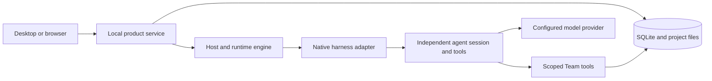

# Architecture

[Development](development.md) · [Working with a team](usage.md) · [中文](../zh-CN/architecture.md)

TeamSwarm has a React interface, a local Node.js service and an Electron desktop shell. The desktop and browser clients use the same product API and persistent state.

## Responsibilities

`teamswarm/src/` renders conversations, collaboration, execution settings, project history and artifacts. `apps/server/src/` implements the control API, persistent product records and native execution. `apps/desktop/` owns the window, local service lifecycle, native folder selection and system credential bridge. `packages/contracts/` contains shared types.

The Host is the user's continuing conversation with a Team. Members own work and use independent native sessions. A Work identifies a responsibility; an Attempt identifies one execution with a captured configuration and native identity. Runtime state distinguishes queueing, execution, stopping, uncertain recovery and completion.

## Delivery and history

Artifacts have stable identities and versioned content. Work submissions, checks and acceptance refer to specific versions. Project documents and history nodes preserve the effective definition and local file snapshots. A new history branch preserves its origin and receives a separate work context.

## Harness boundary

Adapters translate execution configuration to the native harness and observe its events, tool use, session identity and outcome. Scoped Team tools provide project context, requirements, work, communication, submission and review operations. Model credentials are limited to the selected connection. A harness's native conversation is resumed only when its capability and configuration allow it.

## Persistence and recovery

SQLite stores product facts and execution receipts. The runtime records launch intent before native execution and preserves uncertain ownership until recovery can reconcile it. Process creation identity and system boot information help distinguish a live execution from a reused PID or an earlier operating-system boot.

The service is local and single-user. The renderer uses a local control credential; agent-facing Team tools use separately scoped capabilities. Native tool execution retains its configured permissions and operating-system user privileges.

The Host omits the current source message from its recent-history input when its message ID and full content match the request carried by the work. The eight-message selection window stays fixed, and earlier messages with identical wording remain in history.
