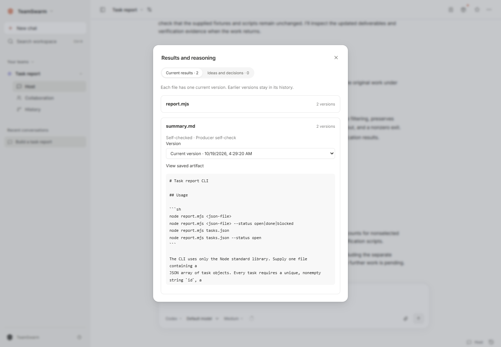

# Your first project

[Install](installation.md) · [Harness setup](harnesses.md) · [中文](../zh-CN/getting-started.md)

This tutorial creates a small task-reporting CLI, verifies its output, then adds a filter in a second turn. It uses synthetic project data and needs one working harness.

## 1. Prepare the project

Copy the contents of [examples/task-report](../../examples/task-report/README.md) into a new folder. Keep the supplied `tasks.json`, `verify.mjs` and `verify-followup.mjs` together. The agent will create `report.mjs` and `summary.md`.

Open TeamSwarm, choose **Create team**, give it a name such as **Task report**, and select that folder in the team's execution settings.

## 2. Connect a harness

For an existing Codex account, choose **Codex** in execution settings. Open its account controls and connect or check your local account. Choose a model offered by that account. Confirm the selected harness and model are available before sending a task.

For an API connection, follow [Harnesses and models](harnesses.md). Start with one resource and one supported configuration. The team can choose more members as the project requires.

## 3. Send the task

Paste this into the Host conversation:

```text
Build the task report described in TASK.md in this project folder.
Create report.mjs and summary.md. Read the supplied tasks.json and keep its
original bytes unchanged. Run node verify.mjs and fix any failures.
Deliver both files and report the command result. Use the existing project
folder and do not change the supplied verification scripts.
```

Follow the work from the team conversation or collaboration view. When a delivery is waiting, open **Deliveries** at the top of the conversation and select it to view the result. Open the delivered files when the work finishes. The CLI should output:

```json
{"total":6,"byStatus":{"open":3,"done":2,"blocked":1}}
```

The verification script checks the real process output, exit codes and invalid-input handling. You can rerun it in the project folder:

```sh
node verify.mjs
```

## 4. Continue the work

Use **Continue modifying** on the delivered work, or ask the Host to continue that work thread:

```text
Continue this task report. Add --status open|done|blocked as described in
FOLLOWUP.md. Validate the complete input before filtering. Preserve the
existing behavior without a filter, update summary.md, and run both
node verify.mjs and node verify-followup.mjs. Deliver the updated versions.
```

Open the latest deliverable and its previous version. The original delivery remains available while the current version reflects the follow-up.

Open **Results and reasoning**, expand a file, and use **Version** to select an earlier artifact. The following screen shows this tutorial's two delivered versions:



## 5. Reopen the workspace

Close and reopen TeamSwarm. Return to the team and work thread, inspect the conversation and files, and ask a read-only question about the report. A supported native session may be resumed; when configuration or harness capabilities require a new session, TeamSwarm reconstructs the work from its saved project state.

If a task is interrupted, follow [Troubleshooting](troubleshooting.md) before retrying it. For an independent review workflow, see [Working with a team](usage.md).
